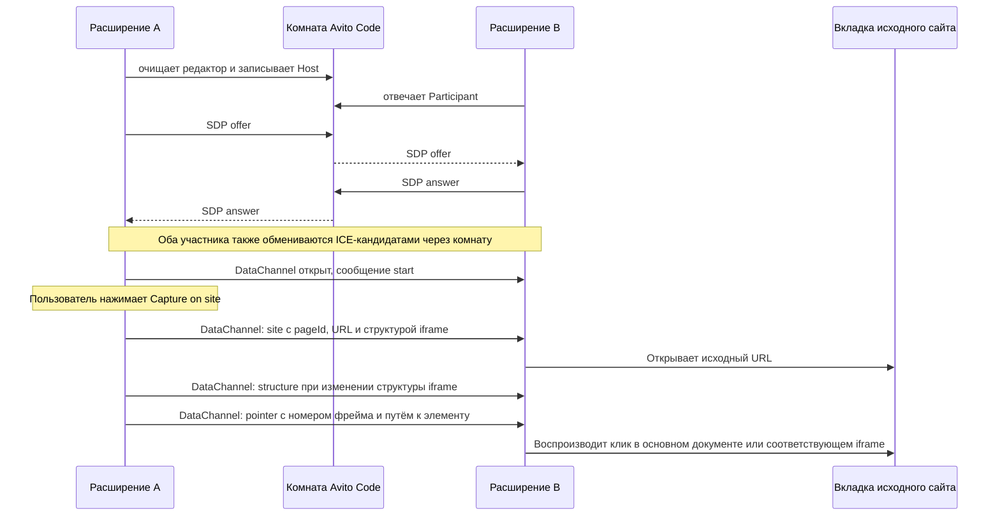

# ScriptCapture — Watch Together

Расширение для Chrome передаёт URL и клики в основном документе и его прямых iframe через WebRTC DataChannel. У получателя открывается обычная вкладка исходного сайта. Сеанс рассчитан на двоих.

## Установка и запуск

1. Выполните `npm ci` в папке проекта с Node.js 24. Затем в Chrome 125 или новее откройте `chrome://extensions`, включите режим разработчика и загрузите папку как распакованное расширение. Сборка не нужна.
2. Хост нажимает **Создать сессию**. Расширение создаёт комнату запросом к Avito Code в фоне и открывает вкладку сразу по выданной ссылке. Хост копирует ссылку из popup. Гость вставляет её и нажимает **Присоединиться**. Закрытие вкладки комнаты сбрасывает сеанс в `IDLE`.
3. В состоянии `Stable` откройте страницу с плеером и нажмите **Capture on site**. Получатель откроет тот же URL в новой вкладке. Переключайте плееры обычными кнопками на странице.
4. После перехода на другой URL снова запустите Capture. Обновите расширение у обоих участников.

## Схема работы



### Подключение

Роли выбираются кнопками. В `IDLE` расширение генерирует имя через `faker.person.firstName()`. Хост генерирует имя сеанса через `faker.git.branch()`. В `Signaling` хост очищает редактор своей новой комнаты и публикует `Host`. Гость читает эту запись и публикует `Participant`. После обеих записей хост инициирует WebRTC.

Каждое служебное сообщение занимает одну строку вида `[ИМЯ] Команда: сообщение`. Пример:

```text
[Mick] Host: message_id=00f35d04-d543-4cf1-b34d-4670513a92c8 session=feature/watch-together
[Robert] Participant: message_id=46c5dae0-3d85-4b70-8fc8-ce871b89250b session=feature/watch-together to=Mick host_id=00f35d04-d543-4cf1-b34d-4670513a92c8
```

Адаптер пишет эти строки через Monaco и ждёт завершения записи ShareDB. У команд `Offer`, `Answer` и `Ice` поле `rtc=` содержит данные WebRTC в формате JSON. Сообщения фильтруются по сеансу, адресату и идентификатору. После `Connection` открытый DataChannel переводит сеанс в `Stable`. Повторное согласование после обрыва отображается как `Reconnecting`, а сбой как `Error`. По умолчанию для ICE используется Google STUN.

### Открытие сайта и воспроизведение

1. Расширение подключает отладчик к вкладкам обоих участников. Chrome показывает уведомление о подключении. [content.js](content.js) слушает пользовательские клики в основном документе и в его прямых iframe, включая фреймы на других доменах.
2. Перед каждым отправленным кликом [player-frame.js](player-frame.js) читает текущие пути к iframe и их адреса без параметров и фрагментов. Если структура изменилась, [offscreen.js](offscreen.js) отправляет её перед кликом. Обновление применяется к открытой вкладке.
3. [remote-site.js](remote-site.js) находит цель по пути в основном документе или внутри соответствующего iframe. Если цель на странице или сам iframe за пределами видимой области, расширение прокручивает к ним, чтобы сайт мог запустить отложенную загрузку плеера. Для следующего клика расширение повторяет поиск фрейма и цели в течение нескольких секунд. Сайт загружает медиа со своей сессией.

### Диагностика

- Статус в popup показывает состояние подключения. Если комната не готова, там же появляется сообщение адаптера редактора.
- При `isDebuggabel = true` в [config.js](config.js) в комнате появляются переходы состояний, идентификатор отправленного сайта, отправленные клики и несовпадения пути к цели.
- Если получатель перенаправлен на другой URL или отключил отладчик, состояние воспроизведения отображается в popup. После перехода отправителя на другой URL запустите Capture заново.

## Ограничения

- Для воспроизведения на обеих вкладках должен совпадать путь к элементу. DOM может отличаться из-за разных сессий, адаптивной разметки или состояния страницы.
- iframe внутри других iframe и iframe внутри Shadow DOM пропускаются. Захват пропускает ссылки, формы и редактируемые поля. Пользовательские клики воспроизводятся синтетическим `PointerEvent` с `isTrusted === false`.
- Комната Avito общая: участники с доступом могут читать записи согласования и диагностики. Закрытие окна не удаляет эти записи. Если изменится внутренний интерфейс Monaco/ShareDB, может потребоваться обновить [avito-editor.js](avito-editor.js).
