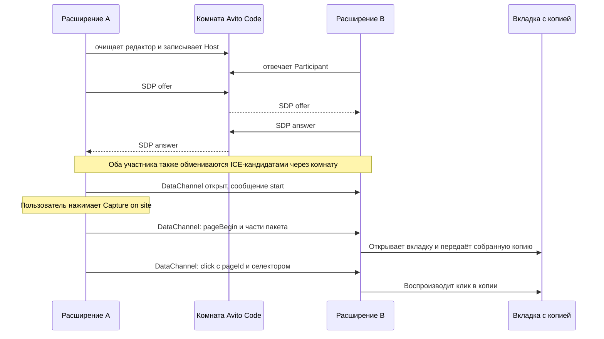

# ScriptCapture — Watch Together

Расширение для Chrome, которое передаёт копию открытой страницы другому участнику через WebRTC DataChannel. Получатель открывает копию в новой вкладке расширения. Клики отправителя воспроизводятся в этой копии. Сеанс рассчитан на двоих.

## Установка и запуск

1. Выполните `npm ci` в папке проекта с Node.js 24. Затем в Chrome 116 или новее откройте `chrome://extensions`, включите режим разработчика и загрузите папку как распакованное расширение. Сборка не нужна.
2. Хост нажимает **Создать сессию**. Расширение создаёт комнату запросом к Avito Code в фоне и открывает вкладку сразу по выданной ссылке. Хост копирует ссылку из popup. Гость вставляет её и нажимает **Присоединиться**. Закрытие вкладки комнаты сбрасывает сеанс в `IDLE`.
3. В состоянии `Stable` откройте popup на вкладке, которой хотите поделиться, и нажмите **Capture on site**. Отправитель становится `isStreamingHost`. У получателя автоматически откроется копия.
4. Чтобы передать другую страницу или обновить копию после перехода, снова нажмите **Capture on site**. Для завершения сеанса нажмите **Отключиться**.

## Схема работы



### Подключение

Роли выбираются кнопками. В `IDLE` расширение генерирует имя через `faker.person.firstName()`. Хост генерирует имя сеанса через `faker.git.branch()`. В `Signaling` хост очищает редактор своей новой комнаты и публикует `Host`. Гость читает эту запись и публикует `Participant`. После обеих записей хост инициирует WebRTC.

Каждое служебное сообщение занимает одну строку вида `[ИМЯ] Команда: сообщение`. Пример:

```text
[Mick] Host: message_id=00f35d04-d543-4cf1-b34d-4670513a92c8 session=feature/watch-together
[Robert] Participant: message_id=46c5dae0-3d85-4b70-8fc8-ce871b89250b session=feature/watch-together to=Mick host_id=00f35d04-d543-4cf1-b34d-4670513a92c8
```

Адаптер пишет эти строки через Monaco и ждёт завершения записи ShareDB. У команд `Offer`, `Answer` и `Ice` поле `rtc=` содержит данные WebRTC в формате JSON. Сообщения фильтруются по сеансу, адресату и идентификатору. После `Connection` открытый DataChannel переводит сеанс в `Stable`. Повторное согласование после обрыва отображается как `Reconnecting`, а сбой как `Error`. По умолчанию для ICE используется Google STUN.

### Захват и открытие копии

1. [background.js](background.js) по нажатию кнопки запускает [capture-page.js](capture-page.js) в основном документе активной вкладки. Захват клонирует текущий DOM и добавляет доступные скрипты, стили и изображения. Внешние ресурсы запрашиваются без cookies.
2. [offscreen.js](offscreen.js) держит WebRTC-соединение открытым после закрытия popup. [page-transfer.js](page-transfer.js) передаёт заголовок `pageBegin` с размером и идентификатором копии, затем двоичные части по 8 КиБ в упорядоченном DataChannel. Лимит всего пакета — 4 МиБ.
3. Когда пакет собран, фоновый обработчик открывает [viewer.html](viewer.html) с идентификатором копии. [viewer.js](viewer.js) получает пакет из offscreen-документа и показывает HTML в [изолированном фрейме](page-sandbox.html). Скрипты копии запускаются в отдельном контексте. Вкладка получателя не переходит на исходный сайт.
4. [content.js](content.js) отслеживает ручные клики в захваченном документе. Сообщение содержит `pageId`, CSS-селектор, поля события и координаты относительно элемента. В копии [page-sandbox.js](page-sandbox.js) ищет подходящий элемент и отправляет ему синтетический `PointerEvent`. Если элемент не найден однозначно, клик пропускается.

### Диагностика

- Статус в popup показывает состояние подключения. Если комната не готова, там же появляется сообщение адаптера редактора.
- При `isDebuggabel = true` в [config.js](config.js) участники дописывают комментарии: переходы состояний, отправку копии, клики и ошибки поиска элемента. Запись `// [Mick] Sent page …` означает, что отправитель поставил пакет в очередь DataChannel. Получение проверяется по появлению копии на втором устройстве.
- Если копия открылась, но клик проигнорирован, проверьте, есть ли соответствующий элемент и обработчик в копии. Её интерфейс показывает сообщение о пропущенном клике при несовпадении элемента.

## Ограничения

- Копия включает основной документ. Вложенные страницы, cookies, состояние JavaScript и обычные видеопотоки не передаются. Сетевые запросы из изолированной копии ограничены. Число пропущенных ресурсов и фреймов отображается во вкладке просмотра.
- Текущий механизм воспроизводит DOM-клики. Захват и реплей произвольных JS-вызовов пока не реализованы. Play/Pause — сценарий проверки: он сработает, если соответствующий плеер запускается в копии и обрабатывает синтетические события.
- Комната Avito общая: участники с доступом могут читать записи согласования и диагностики. Закрытие окна не удаляет эти записи. Если изменится внутренний интерфейс Monaco/ShareDB, может потребоваться обновить [avito-editor.js](avito-editor.js).
